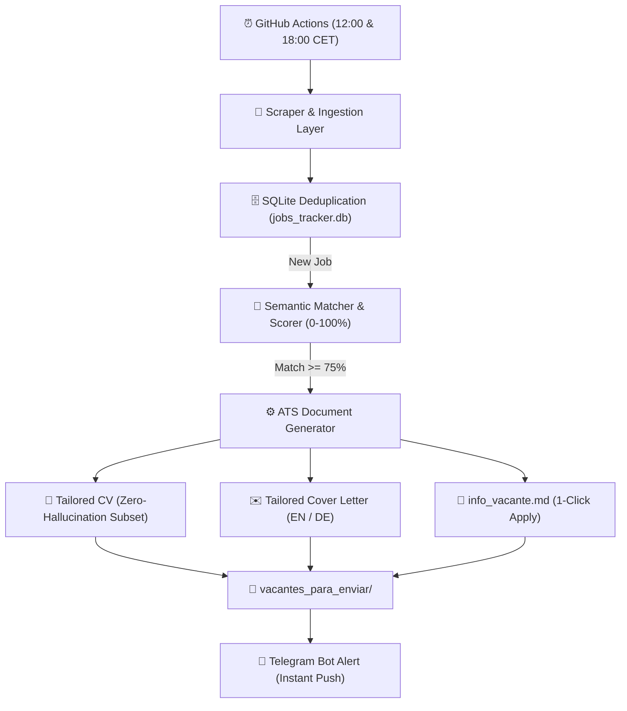

# 🎯 Berlin Job Application Agent (Indeed DE)

[](.github/workflows/berlin_job_monitor.yml)
[-FF6B6B)](design_draft.md)
[](config/settings.json)
[](requirements.txt)

An automated, intelligent job discovery and application staging engine tailored for the **Berlin tech market** (`de.indeed.com`). It continuously identifies high-fit software engineering positions, matches them against a canonical **Master Candidate Profile**, and generates personalized, ATS-optimized CVs and Cover Letters (*Anschreiben*) staged for human-in-the-loop review.

Developed following the **Elephant Goldfish Model (EGM)** multi-agent engineering methodology.

---

## 🏛️ System Architecture



---

## ✨ Key Architectural Highlights

* **Elephant Goldfish Model (EGM):** Designed through continuous audit cycles with specialized reviewer agents (`egm-design` and `egm-implementation-readiness`), ensuring resilience against anti-bot challenges and airtight data contracts.
* **Strict Zero-Hallucination Policy:** The CV generator enforces a *strict subset constraint*—bullet points and metrics are strictly filtered and reordered from the candidate's canonical `perfil_maestro.json`. The AI never fabricates skills, dates, or companies.
* **Bilingual Support (Berlin Standards):** Automatically detects job language. German vacancies produce formal German application materials (*Siezen*), while international vacancies generate standard English materials.
* **Persistent Deduplication:** Uses an indexed SQLite database (`jobs_tracker.db`) with SHA-256 hashing to ensure the candidate never reviews or applies to the same posting twice.
* **100% Cloud Execution & Telegram Alerts:** Runs fully automated on GitHub Actions twice daily (12:00 PM and 6:00 PM Berlin time) and sends instant push alerts to Telegram with one-click apply links.

---

## 📂 Project Structure

```
berlin_job_agent/
├── .github/workflows/
│   └── berlin_job_monitor.yml    # Cron runner (12:00 & 18:00 CET)
├── config/
│   └── settings.json             # Search parameters, filters & thresholds
├── mi_perfil/
│   ├── perfil_maestro.json       # Consolidated 8+ year professional profile
│   └── documentos_fuente/        # Historical resumes and source docs
├── src/
│   ├── matcher.py                # Skills extraction & compatibility scoring
│   ├── generator.py              # ATS CV & Cover Letter builder
│   ├── notifier.py               # Telegram Bot push notification dispatcher
│   └── storage.py                # SQLite state management & deduplication
├── templates/
│   ├── cv_master.md              # Base CV template
│   └── cover_letter_templates.json # English & German letter templates
├── vacantes_para_enviar/          # ⭐ Daily review inbox (auto-generated)
├── design_draft.md               # Formal EGM engineering design document
├── review_egm_design.md          # Hostile Design Critic audit report
├── review_egm_implementation.md  # Pragmatic Tech Lead audit report
├── run_pipeline.py               # Pipeline orchestrator & CLI
└── requirements.txt
```

---

## 🚀 Quickstart & Usage

### 1. Local Execution
```bash
# Clone the repository
git clone https://github.com/Jsscrdng/berlin-job-agent.git
cd berlin-job-agent

# Install dependencies
pip install -r requirements.txt

# Run sample intake
python run_pipeline.py --sample

# Ingest a specific job posting manually
python run_pipeline.py --url "https://de.indeed.com/viewjob?jk=example" --company "SoundCloud" --title "Senior Backend Engineer"
```

### 2. GitHub Actions & Telegram Setup
1. Push this repository to GitHub.
2. In your GitHub repository, go to **Settings > Secrets and variables > Actions**.
3. Add two repository secrets:
   * `TELEGRAM_BOT_TOKEN`: Token obtained from `@BotFather`.
   * `TELEGRAM_CHAT_ID`: Your personal Telegram user ID (or channel ID).
4. That's it! GitHub Actions will run automatically at **12:00 PM** and **6:00 PM Berlin time** and message you on Telegram whenever matching jobs are found.

---

## 👤 Author
**Jesús Cárdenas A**  
*Senior Software Engineer / Backend & Fullstack Developer*  
Berlin, Germany • [LinkedIn](https://linkedin.com/in/jesuscardenas) • [GitHub](https://github.com/Jsscrdng)
